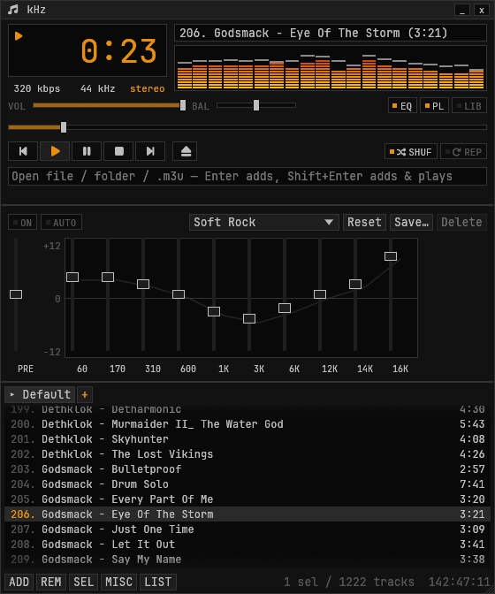

# khz-player

A Winamp-classic style music player for Linux, written in Rust.



- Main window with time display, scrolling title, spectrum analyzer, volume and balance.
- 10-band equalizer with presets (built-in and your own) and AUTO mode, which
  remembers the preset chosen for each track.
- Several playlists, stored in SQLite; M3U import and export; a play queue (Q).
- Media library scanned from your music folders, with a search box.
- Gapless playback (can be turned off); MP3 (and MP1/MP2), FLAC, Ogg Vorbis, AAC and ALAC in
  M4A/MP4, WAV and AIFF. Opus, WavPack, APE and Musepack are not supported.
- ReplayGain (track, album or auto) with preamp and a gain for untagged tracks; peaks are never clipped.
- MPRIS, so media keys and desktop widgets can control it, with cover art.
- Uses the current Omarchy theme colors and follows theme switches;
  falls back to the classic Winamp palette elsewhere.

## Install a release

Prebuilt binaries for x86_64 Linux are on the
[releases page](https://github.com/BrilllianD/khz-player/releases). They run on
any distribution with glibc 2.35 or newer: Ubuntu 22.04+, Debian 12+, Fedora 36+,
Arch and its derivatives such as Omarchy.

Runtime needs: ALSA (`alsa-lib` on Arch, `libasound2` on Debian and Ubuntu,
`alsa-lib` on Fedora), `pipewire-pulse` or `pulseaudio` for the PulseAudio
backend (without it, audio falls back to ALSA, and on PipeWire that goes
through `pipewire-alsa`) and a Wayland
or X11 desktop with OpenGL. A D-Bus session bus is optional, for MPRIS.

```sh
v=0.2.1
curl -LO https://github.com/BrilllianD/khz-player/releases/download/v$v/khz-player-$v-x86_64-linux.tar.gz
curl -LO https://github.com/BrilllianD/khz-player/releases/download/v$v/khz-player-$v-x86_64-linux.tar.gz.sha256
sha256sum -c khz-player-$v-x86_64-linux.tar.gz.sha256
tar xzf khz-player-$v-x86_64-linux.tar.gz
./khz-player-$v-x86_64-linux/install.sh
```

`install.sh` puts the binary in `~/.local/bin`, plus the desktop entry and icons
under `~/.local/share`, so khz-player shows up in app launchers. For a
system-wide install use `PREFIX=/usr/local sudo -E ./install.sh`. To remove it,
run `./install.sh --uninstall` with the same `PREFIX`. Settings and the library
in `~/.config/khz-player` and `~/.local/share/khz-player` are kept.

## Build and run

Needs Rust 1.98 or newer, plus ALSA development headers (`alsa-lib`).
Audio uses the PulseAudio protocol (`pipewire-pulse`) when it is available and
ALSA otherwise. No libpulse headers are needed.

```sh
cargo run --release -- [files | folders | playlist.m3u]...
```

Arguments are added to the current playlist and the first one starts playing.
Without arguments khz-player loads the last track; if you quit mid-track, it waits
paused at the same spot.

To install for your user:

```sh
cargo install --path . --root ~/.local --locked
install -Dm644 khz-player.desktop ~/.local/share/applications/khz-player.desktop
for s in 16 24 32; do
  install -Dm644 assets/icons/dark-small/png/khz-icon-dark-small-$s.png ~/.local/share/icons/hicolor/${s}x${s}/apps/khz-player.png
done
for s in 48 64 128 256 512; do
  install -Dm644 assets/icons/dark/png/khz-icon-dark-$s.png ~/.local/share/icons/hicolor/${s}x${s}/apps/khz-player.png
done
install -Dm644 assets/icons/dark-small/khz-icon-dark-small.svg ~/.local/share/icons/hicolor/scalable/apps/khz-player.svg
update-desktop-database ~/.local/share/applications
```

`--root ~/.local` puts the binary in `~/.local/bin`, which is on the PATH of an
Omarchy session; `~/.cargo/bin` is not, so app launchers would not find `khz-player`
there.

`scripts/package.sh` builds the release tarball into `dist/`. It needs Docker
and compiles inside Ubuntu 22.04, so the binary does not depend on the host's
newer glibc.

## Keyboard

| Key | Action |
| --- | --- |
| `Z` `X` `C` `V` `B` | Previous, play (restarts when playing), pause / resume, stop, next |
| `Space` | Play / pause |
| `←` `→` | Seek 5 s back / forward |
| `↑` `↓`, `+` `-` | Volume up / down (`↑` `↓` move the cursor instead while the playlist has focus) |
| `R` | Cycle repeat (off, all, one) |
| `S` | Toggle shuffle |
| `L` | Add files (opens the file dialog) |
| `J` | Jump to a track by name |
| `Q` | Queue / unqueue the selected tracks (played next, in order; Ctrl+Enter in the jump dialog) |
| `↑` `↓` (playlist focused) | Move the cursor |
| `Shift+↑` `Shift+↓` | Extend the selection |
| `PgUp` `PgDn` `Home` `End` | Move the cursor by a page / to the ends; with `Shift`, extend the selection |
| `Ctrl+↑` `Ctrl+↓` | Move the selected tracks up / down |
| `Enter` | Play the track under the cursor (or the first selected) |
| `Del` | Remove selected tracks |
| `Ctrl+A` | Select all |
| `Ctrl+T` | Switch elapsed / remaining time |
| `Ctrl+V` | Stop after the current track (toggle) |
| `Ctrl+S` | Start / cancel the sleep timer (fades out over 10 s, then pauses) |
| `Alt+G` / `Alt+E` / `Alt+L` | Show or hide equalizer / playlist / library |

Clicking the playlist gives it keyboard focus (its border turns the accent
color); clicking anywhere else or hiding it returns the arrows to volume.

## Mouse

- Double-click a track to play it; right-click for its menu.
- Drag tracks to reorder them; a selection moves as one block.
- Shift-click and Ctrl-click select ranges and single tracks.
- Click the time display to switch between elapsed and remaining.
- Hover over the seek bar to see the time under the pointer.
- Scroll over the volume bar to change volume; double-click the balance bar to center it.
- Drag the title strip to move the window.
- Dropping files or folders onto the window adds them under X11 only; under
  Wayland it does nothing (winit has no Wayland drag and drop), so use the
  file dialog (`L`, eject button), ADD > "Type a path…" or the library.

The playlist footer shows the count and length of the selected tracks next to
the totals. Its menus hold the rest: ADD, REM (remove missing files,
duplicates by path or by tags), SEL, MISC (sort, reverse, randomize) and LIST
(new, rename, delete, import and export M3U).

## Files

| Path | Contents |
| --- | --- |
| `~/.config/khz-player/config.toml` | Settings, window state, last track and position |
| `~/.config/khz-player/eq_presets.toml` | Your equalizer presets |
| `~/.local/share/khz-player/library.db` | Library, playlists, per-track AUTO presets |

A pre-rename `~/.config/rmp` or `~/.local/share/rmp` is moved to the new
location automatically on first start.

Useful keys in `config.toml`:

- `library_roots`: folders to scan (defaults to your music folder).
- `font_path`: font file to use. khz-player looks for JetBrainsMono Nerd Font by
  default and uses its icons when found.
- `follow_omarchy_theme`: `true` (default) follows the current Omarchy theme; `false`
  uses the Winamp colours.

`Ctrl+P` (or the gear in the title bar) opens the settings window. It has four
sections: Library (library folders, rescan), Playback (gapless, sleep timer), Audio (ReplayGain), and Appearance (theme,
animation frame rate, remaining-time display, font file).

## Hyprland

khz-player draws its own title bar and is meant to float. With Omarchy's Lua config,
add to `~/.config/hypr/looknfeel.lua`:

```lua
o.window("^(khz-player)$", { float = true, size = { 560, 760 } })
```

Without the Omarchy helper:

```lua
hl.window_rule({ match = { class = "^(khz-player)$" }, float = true, size = { 560, 760 } })
```

## MPRIS

khz-player registers as `org.mpris.MediaPlayer2.khz-player`. The cover (embedded, or
`cover`/`folder`/`front` `.jpg`/`.png` next to the file) is published as `mpris:artUrl`;
embedded covers are cached in `~/.cache/khz-player/art`.

Settings > Playback has "Notify on track change" (off by default): while the window is
unfocused, each started track shows a desktop notification with title, artist, album and cover.
It needs a notification daemon such as mako or swaync.

Running `khz-player FILE…` while it is already open adds the files to the current
playlist of the running window.

```sh
playerctl -p khz-player play-pause
busctl --user call org.mpris.MediaPlayer2.khz-player /org/mpris/MediaPlayer2 \
    org.mpris.MediaPlayer2.Player PlayPause
busctl --user get-property org.mpris.MediaPlayer2.khz-player /org/mpris/MediaPlayer2 \
    org.mpris.MediaPlayer2.Player Metadata
```

## Logging

```sh
RUST_LOG=khz_player=debug khz-player
```

## License

khz-player is free software, licensed under the GNU General Public License,
version 3 or (at your option) any later version. See `LICENSE`.

Third-party crates keep their own licenses: mostly MIT and Apache-2.0, and
MPL-2.0 for symphonia and mpris-server. The fonts egui embeds are under the
OFL-1.1 and the Ubuntu Font Licence.
